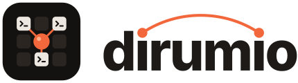
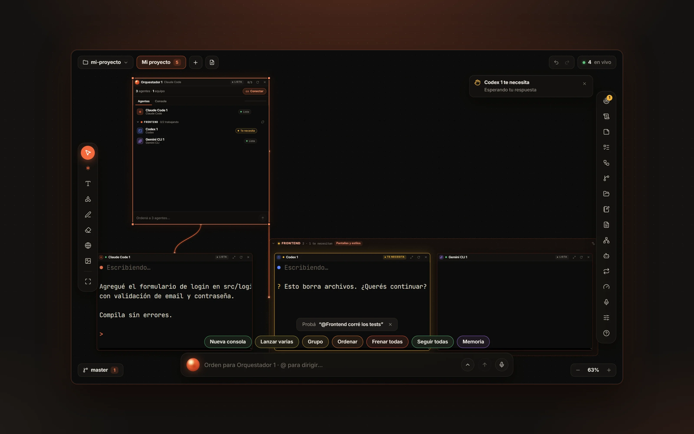
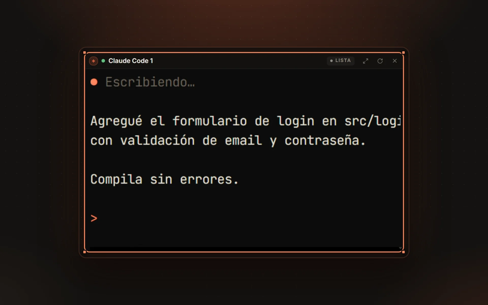
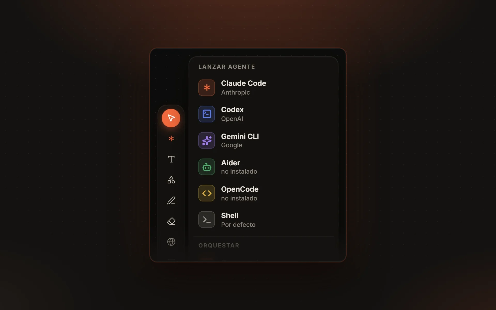
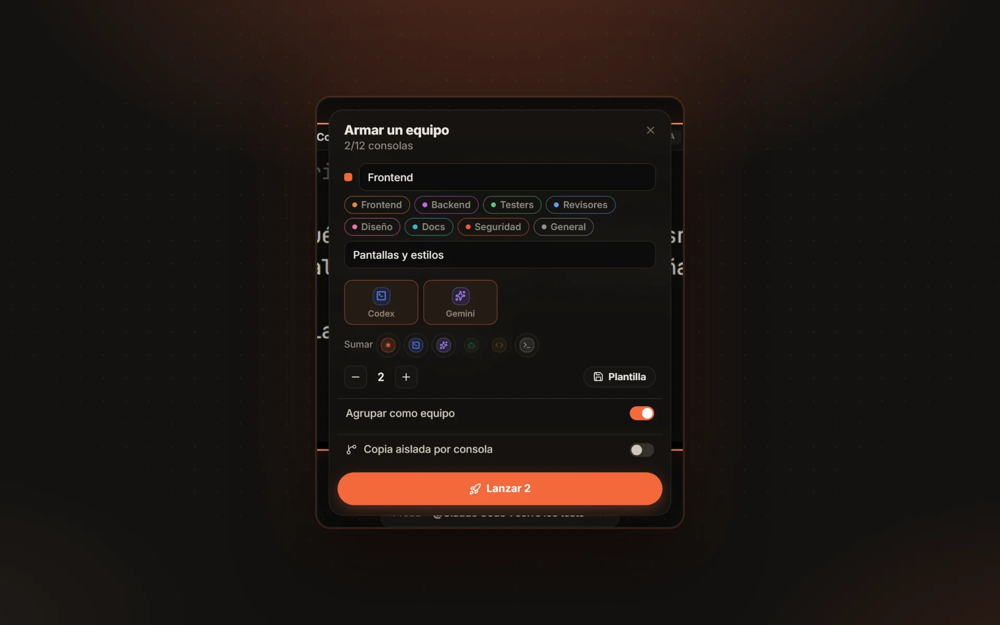
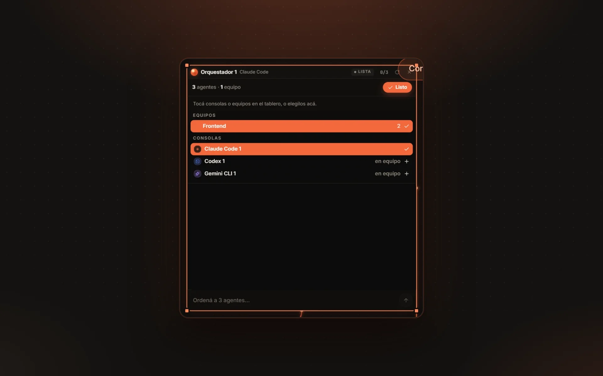
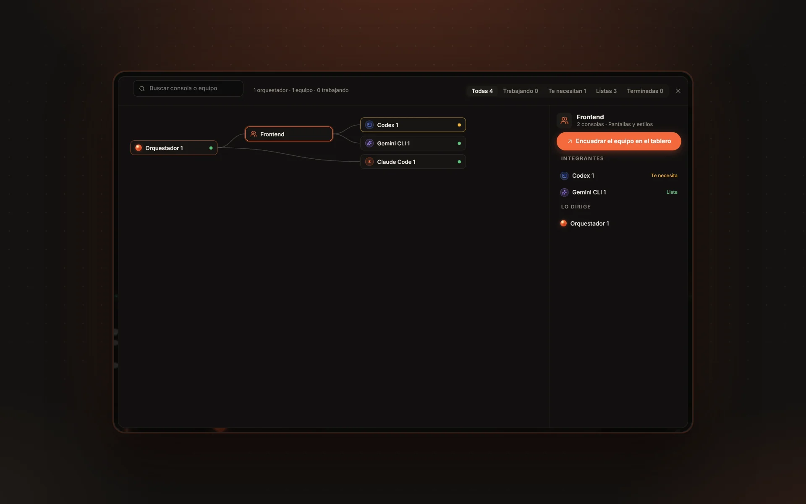
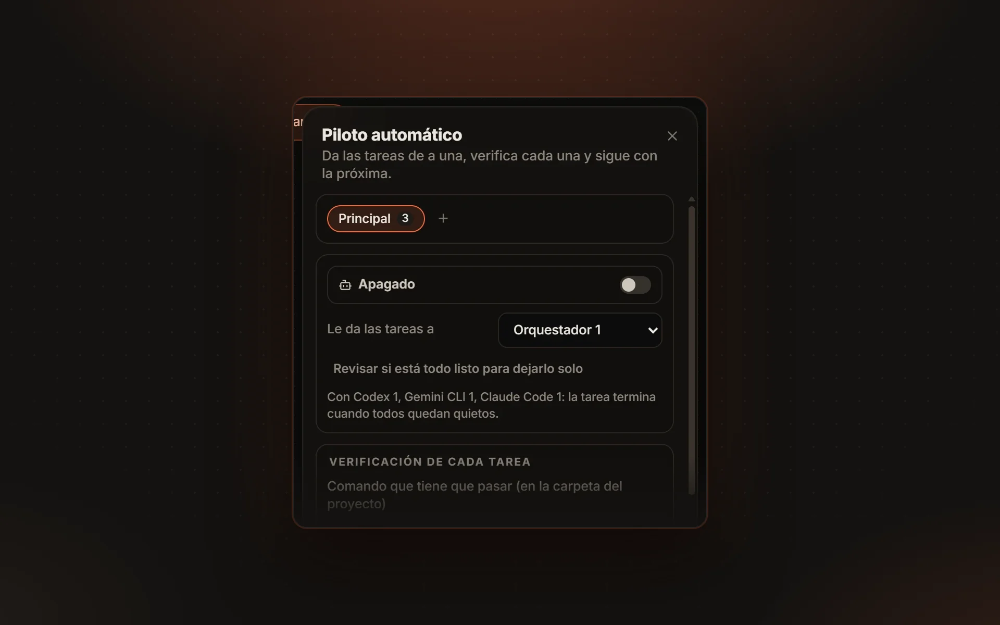
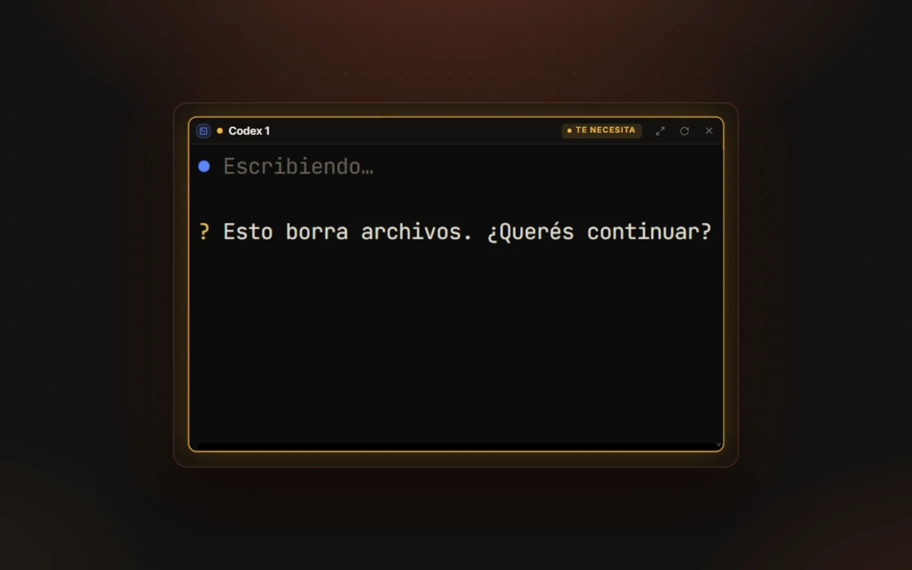
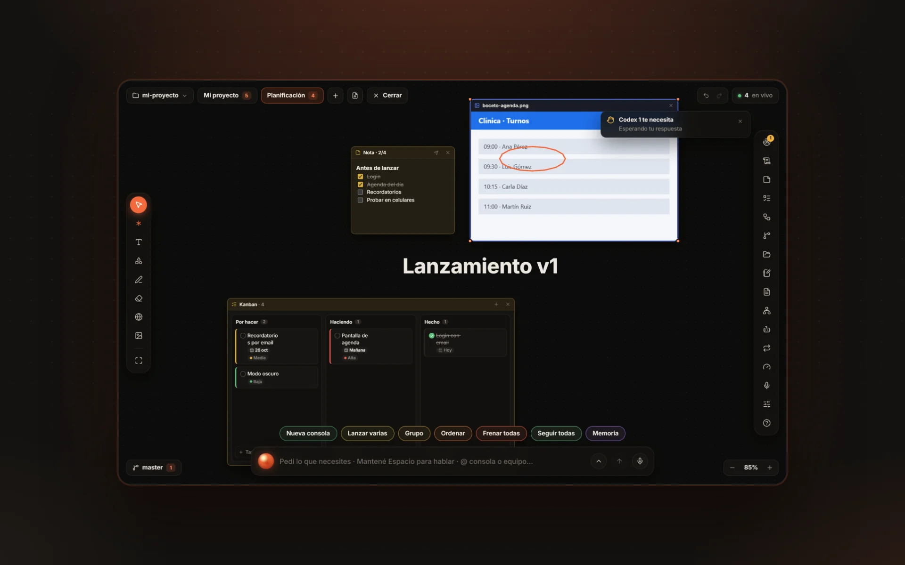

<p align="center">
  <picture>
    <source media="(prefers-color-scheme: dark)" srcset="assets/logo-claro.svg">
    
  </picture>
</p>

<h3 align="center">Tus agentes de IA, trabajando juntos en un mismo tablero.</h3>

<p align="center">
  Claude Code, Codex, Gemini CLI o el que uses, cada uno en su consola real.<br>
  Los ves trabajar, los armás en equipos y los dirigís con un orquestador o con tu voz.
</p>

<p align="center">
  
  
  
  
</p>

<p align="center">
  <a href="https://github.com/GEELLOW3D/dirumio-versiones/releases/latest"></a>
  <a href="https://github.com/GEELLOW3D/dirumio-versiones/releases/latest"></a>
</p>

<p align="center">
  
</p>

> 🔑 **Prueba cerrada.** Para usar Dirumio hace falta una **clave de activación**, que por ahora se da a mano. Sin
> clave, la app no abre.

## Qué podés hacer

<table>
  <tr>
    <td width="50%" valign="top">
      
      <h3>🖥️ Agentes en consolas reales</h3>
      Cada agente trabaja sobre tu proyecto en su propia consola. Ves lo que hace y le respondés ahí mismo.
    </td>
    <td width="50%" valign="top">
      
      <h3>🧩 El agente que quieras</h3>
      Claude Code, Codex, Gemini CLI, Aider, OpenCode o una consola común. Cualquier otro se suma con un archivo de
      configuración.
    </td>
  </tr>
  <tr>
    <td width="50%" valign="top">
      
      <h3>👥 Equipos con roles</h3>
      Armá un grupo de consolas con nombre y rol (Frontend, Testers, Revisores…) y hablale a todo el equipo de una vez.
    </td>
    <td width="50%" valign="top">
      
      <h3>🎯 Un orquestador que reparte</h3>
      Conectalo con cables a tus agentes: divide una tarea grande, le da a cada uno su parte y revisa lo que hicieron.
    </td>
  </tr>
  <tr>
    <td width="50%" valign="top">
      
      <h3>🗺️ Mapa de misión</h3>
      Quién dirige a quién, quién está trabajando y quién te necesita, de un vistazo.
    </td>
    <td width="50%" valign="top">
      
      <h3>🤖 Piloto automático</h3>
      Una cola de tareas que se hacen solas, una por una, verificadas con tus pruebas. También programadas o pedidas
      desde el celular.
    </td>
  </tr>
  <tr>
    <td width="50%" valign="top">
      
      <h3>🔔 Te avisa cuando te necesita</h3>
      Si un agente pide permiso o termina un trabajo largo, te enterás: en la pantalla, en el escritorio o en el
      celular.
    </td>
    <td width="50%" valign="top">
      
      <h3>🗂️ Todo en un mismo tablero</h3>
      Notas, kanban, checklist, calendario, imágenes con anotaciones, tu app en un navegador y el código, al lado de
      los agentes.
    </td>
  </tr>
</table>

Y además: **dictado por voz** que corre en tu PC, **bucles** y **flujos** entre agentes, **memoria del proyecto**,
**copias aisladas** para que cada agente trabaje sin pisar a los otros, y una **bitácora** con lo que pasó mientras no
estabas.

## Instalar

Todo se baja de **[la última versión](https://github.com/GEELLOW3D/dirumio-versiones/releases/latest)**. Al abrir
Dirumio por primera vez, pegá tu clave: sirve en todas tus computadoras.

### Windows 10 u 11

1. Bajá `Dirumio-Setup-<versión>.exe` y abrilo.
2. Como todavía no está firmado, Windows puede mostrar "Windows protegió su PC": tocá
   **Más información › Ejecutar de todas formas**.
3. Elegí la carpeta y terminá la instalación (no pide permisos de administrador).

### Mac

1. Bajá el `.dmg` de tu Mac: `Dirumio-<versión>-arm64.dmg` si tiene Apple Silicon (M1 o posterior), o
   `Dirumio-<versión>-x64.dmg` si tiene Intel (desde la 0.2.0). Abrilo y arrastrá **Dirumio** a **Aplicaciones**.
2. Como todavía no está firmado por Apple, la primera vez la Mac lo bloquea (dice que "está dañado" o que no puede
   verificar al desarrollador). Abrí la **Terminal** y pegá esto una sola vez:

   ```bash
   xattr -cr /Applications/Dirumio.app
   ```

3. Abrí Dirumio desde Aplicaciones.

Linux: próximamente.

## Qué necesitás

- **Al menos un agente** instalado y con tu cuenta, por ejemplo Claude Code o Codex. Dirumio los usa, no los
  reemplaza.
- **Git y Node.js.** Si te faltan, el Diagnóstico de la app (_Preferencias › Revisar si esta computadora está lista_)
  los instala.

## Actualizaciones

En **Windows**, Dirumio se actualiza solo: baja las versiones nuevas en segundo plano y te ofrece reiniciar; si no
reiniciás, se instala al cerrar la app.

En **Mac**, mientras no esté firmado por Apple, las versiones nuevas se bajan a mano de esta página: instalala encima de
la anterior y repetí el paso de la Terminal.

En los dos, tus tableros y tu configuración se mantienen.

---

<p align="center">
  <sub>Software propietario · Todos los derechos reservados<br>Este repositorio solo publica los instaladores; el código no es público.</sub>
</p>
